# JobPilot

**JobPilot 求职自动投递助手** —— 登录、找职位、简历匹配、AI 写招呼语、一键投递，一条龙跑通，协议全部走真实接口。首个接入平台为 BOSS 直聘。

```
登录 ──► 找职位 ──► 简历匹配 ──► 招呼语 ──► 投递
```

> 后续会更新其他平台

---

## 下载

到 Releases 页面的 **Assets** 里下 `JobPilot-x.y.z.zip`，无需 Python：

| 来源 | 地址 |
|------|------|
| **GitHub** | https://github.com/handsomekai924/jobpilot/releases |
| **Gitee**（国内更快） | https://gitee.com/w-kev/jobpilot/releases |

装好后有新版本会在网页里提示，点「立即更新」就地升级。从 1.x 升到 2.0.0 需要手动替换一次，详见 Release 页面的更新说明。

---

## 安装

**打包版**：解压到任意目录即装好。**数据存在解压目录的 `data\` 里**（登录态、简历、职位库、日志），换机器时把整个文件夹拷走即可。

**源码版**：Python 侧是 uv workspace，一条 `uv sync` 把所有包与依赖装进 `.venv`。先装 uv（没装的话）：

```bash
powershell -c "irm https://astral.sh/uv/install.ps1 | iex"   # Windows
curl -LsSf https://astral.sh/uv/install.sh | sh              # macOS / Linux
# 或 pip install uv
```

```bash
git clone https://github.com/handsomekai924/jobpilot.git
cd jobpilot
uv sync              # 装齐 Python 包与依赖（Python 3.12+ 由 uv 自动备好）
pnpm install         # 前端依赖（需 Node.js + pnpm）
```

环境：Chrome 浏览器、一个能收短信的手机号（打包版不需要 Python）。

---

## 启动

**打包版**：双击 `JobPilot.exe`，浏览器自动打开控制台。

**源码版**（前后端分开启动）：

```bash
uv run python -m jobpilot_server    # API 服务：http://127.0.0.1:8787
pnpm dev                            # 前端：http://127.0.0.1:5173
```

启动时只打印接口地址与接口文档地址，不会自动打开浏览器。端口被占用会自动往后顺延，前端代理跟着实际端口走。

常用参数：`--reload` 改代码自动重启（开发用）、`--self-check` 只做路径/环境自检、`--port` 指定端口。

---

## 第一次使用（按顺序走一遍）

### 1. 登录 BOSS 账号

顶部导航是共用功能（总览 / 简历 / 匹配 / 面试题 / 任务 / 设置）；**登录、找工作、投递属于平台工作区**。

进入方式：**总览页 → 点 BOSS直聘 平台卡片**，或点顶栏平台胶囊旁的「**进入工作区**」按钮 → 左侧栏出现「登录 / 找工作 / 投递」。

- 短信验证码：填手机号 → 发码 → 填验证码
- 扫码登录：用 BOSS App 扫码
- 遇到滑块：由你本人拖动官方组件，程序不代拖

登录态保存在本地库里，下次打开一般不用重登；失效时页面顶部会提示。

### 2. 配置 AI 模型

「设置」页 → 「模型档案」：

- 填 **API Key / Base URL / 模型名** 三样，接口需兼容 OpenAI Chat Completions
- 支持多套档案（DeepSeek / Kimi / 中转站 / 本地 vLLM 都行），点「激活」切换当前使用的一套
- 「拉取模型」可以列出该地址下的可用模型；「测试连通」验证 Key 和地址
- Key 只存本地数据库，不上传

> 如果用的是限制并发的接口（例如「同时最多 1 个请求」），程序会自动退避重试并转串行，不用手动改配置，只是会慢一些。

### 3. 采集职位

「找工作」页 → 「采集配置」：

| 条件 | 说明 |
|------|------|
| 关键词 | 可一次填多个（逗号/顿号/分号/换行分隔，最多 10 个），按词逐个串行采集，如 `后端开发,AI应用,Python、全栈` |
| 城市 / 经验 / 学历 / 行业 / 规模 / 阶段 | 可多选；城市为单选 |
| 薪资 | 单选（BOSS 接口只收一档），选你能接受的最低档即可，具体薪资在岗位卡片里 |
| 期望流 | 优先用你 BOSS 账号里的在线求职期望，比关键词更准 |
| 采集参数 | 最多几页、起始页、翻页间隔（默认 1 秒，别调太小） |

点「开始采集」，进度在任务中心。采集回来的岗位进入职位库，命中的黑名单会**入库但打标**，方便核对规则。

### 4. 上传简历并解析

「简历」页 → 「简历库」→ 上传（支持 Word / PDF / Markdown / 纯文本）→ 自动发起 AI 解析。

「简历解析」段展示八段结构化结果：基本信息、求职意向、工作经历、项目经历、教育经历、技能标签、自我评价、摘要。

- **解析结果可以直接编辑**：点右上角「编辑」，修正 AI 解析错误（改文字、增删经历/亮点、增删技能），保存后写回数据库
- 匹配、生成招呼语用的都是这份结构化数据，改完立即生效
- 摘要（约 300 字）是匹配时重点参考的内容，值得花一分钟校对
- 解析失败的 PDF（字体编码特殊时会出乱码原文），建议换 Word/Markdown 重新上传

### 5. 跑匹配

「匹配」页 → 「匹配工作台」：

1. 选简历
2. 选抓取批次（或留空按搜索范围）
3. 可勾选部分岗位只匹配这几个；不勾 = 按批次/全库
4. 点「开始匹配」，进度和事件流在任务卡里

结果按匹配分从高到低排列，每张卡显示：分数、岗位/公司/薪资、匹配理由、建议、招呼语。可以：
- 直接改招呼语 → 保存
- 「重新生成」让 AI 按当前规则重写一条草稿
- 「重跑」对单条重新匹配
- 「匹配详情」展开技能匹配、优势、风险

**候选列表会标记已投递**：30 天冷却内的岗位默认隐藏（点「已隐藏已沟通」可切回显示），显示时不可勾选，避免重复投递。

### 6. 设置招呼语（三种模式，按需选一种）

「匹配」页 → 「招呼语」段：

- **AI 生成（默认）**：下方「招呼语要求」是给 AI 的生成规则，100–150 字、突出匹配点等；可自定义后保存，下次生成/重新生成立即生效
- **固定招呼语**：在上面「固定招呼语」填一段文案，**所有岗位统一用它，不再调用 AI**
- **只建会话（不发自定义正文）**：打开开关后投递只点「立即沟通」，正文用 BOSS 账号里配置的默认打招呼语

> 为什么有第三个开关：BOSS 的「立即沟通」在配置过账号默认打招呼语时**会自动发那条**，程序再发一条就变成两条。要么关掉这个开关并在 BOSS 里清空默认招呼语（用程序发的），要么打开开关只让 BOSS 发。二选一，别两边都发。

### 7. 投递

「找工作」/「投递」所在的平台工作区 → 左侧栏「投递」：

1. 选分析结果
2. 评分阈值默认 70，低于阈值的不进「一键发送」清单
3. 勾选要发的位置（建议先小批量试 2–3 个）
4. 「选中发送」或「一键发送」，弹窗确认后开始

投递规则（程序内置）：

- 串行发送，条间隔默认 40 秒（随机浮动，模拟真人节奏）
- 每日发对话配额默认 100 次，到顶自动停
- 同一岗位 30 天内不重复发
- 单条失败只记录原因、继续下一条，不自动重试（可在匹配页对该条点「重跑」或重新发起）
- 撞账号异常 / 人机验证会**立即停整批**，这是保护机制，不是故障

发送结果写回匹配卡片：成功显示「已投递 · 时间」，失败显示「发送失败：原因」。

---

## 功能详解

### 页面结构

| 区域 | 入口 | 内容 |
|------|------|------|
| 共用页 | 顶部导航 | 总览 / 简历 / 匹配 / 面试题 / 任务 / 设置 |
| 平台工作区 | 总览页点平台卡片，或地址 `/#/boss/login` | 登录 / 找工作 / 投递（左侧栏） |

### 简历优化

「简历」页 → 「简历优化」：

- **定向优化**：选目标岗位（勾具体岗位 / 选抓取批次 / 全库），AI 按 JD 改写简历
- **自由优化**：选章节 + 提示词（有预设库），按你的要求改写
- 生成完成后到「优化记录」看 diff、变更点，可下载 md/txt，或「确认保存」入库为**一份新简历**（原简历不覆盖）

### 找出题 / 面试准备

「面试题」页：可按匹配分析或抓取批次批量生成岗位面试题，支持补题（按题型）、按岗位查看/编辑、导出。生成记录里可以回看历史题目。

### 任务中心

顶部「任务」页统一管理所有长任务（采集、解析、匹配、投递、出题、更新），可看进度、事件流水、取消、重试。**注意：任务历史仅保留本次运行（内存中），重启后清空**；投递结果本身已写进数据库，不会丢。

### 黑名单与岗位过滤

「设置」→「黑名单规则」：

- **公司规则**：按公司名匹配（包含/完全/正则），命中后公司下所有岗位标记
- **JD 关键词**：按职位描述匹配关键词（如「外包」「销售」）
- 可先「测试」一条规则再看命中记录
- 采集时命中的岗位仍会入库并打标，匹配/投递阶段会自动拦截；已入库的岗位可点「重扫」重新检查

### AI 设置细节

- 多套档案：常见做法是按用途各建一套（如快速模型做匹配、强模型做简历优化），用时激活
- 采样参数（temperature / max_tokens / timeout）是系统固定值，界面不可改
- 若上游报 429 / 并发限制：程序自动退避重试，必要时整批转串行；日志里能看到重试记录

### 数据与日志

打包版所有数据都在 `JobPilot\data\`：

| 路径 | 内容 |
|------|------|
| `data\jobpilot.db` | 主库：登录态、简历与解析、职位库、匹配分析、投递状态、设置 |
| `data\logs\jobpilot.log` | 运行日志（打招呼耗时/失败原因、限流重试、任务错误等） |
| `data\exports\` | 简历优化导出文件 |
| `data\chrome_profile\` | 登录/滑块用的浏览器配置目录 |

**备份**：直接复制整个 `data\` 目录即可。升级/重装前建议先备份；换机器把整个安装目录拷走。

---

## 常见问题

**Q：页面打开了但提示连不上本地程序？**
确认黑色命令行窗口（后端进程）还开着，关掉它就等于关掉程序；然后刷新页面。

**Q：登录态失效了？**
到平台工作区「登录」页重新登录。程序启动时也会自检一次登录态。

**Q：匹配结果全是「匹配失败」？**
看卡片上的失败原因。常见是上游限流（文案会提示「请求太频繁」），程序已自动重试；仍然失败就换一套模型档案或等几分钟。也检查「设置 → 模型档案」里的 Key/地址/模型名。

**Q：投递页找不到？**
投递在平台工作区，不在顶部共用导航。从「总览」页点 BOSS直聘 平台卡片进入，或直接访问 `http://127.0.0.1:8787/#/boss/deliver`。

**Q：BOSS 里每个岗位收到两条一模一样的招呼语？**
你 BOSS 账号配置了默认打招呼语，`立即沟通` 自动发了它，程序又发了一条。二选一：打开「匹配 → 招呼语 → 只建会话」开关（只用 BOSS 默认），或清空 BOSS 账号里的默认打招呼语（只用程序发的）。

**Q：上传 PDF 解析出来是乱码？**
部分 PDF 字体编码特殊，文本提取会乱。换 Word（.docx）或 Markdown 重新上传最稳。

**Q：同一个岗位还会再发吗？**
30 天冷却内不会。候选列表会标记并默认隐藏已投递岗位；投递页也会跳过。

**Q：每天能投多少？**
默认 100 次（可在站点设置里调），条间隔默认 40 秒。到顶自动停，第二天恢复。

---

## 开发

```bash
uv run pytest        # 测试
packaging\build.bat  # 打包 exe（需 pnpm，产物在 dist\）
```

打包脚本会先构建前端（`apps/web` → `packages/.../static/dist`），再 PyInstaller 生成 `dist\JobPilot\` 与发行 zip。**注意：脚本会清空 `dist\`，升级前先备份 `dist\JobPilot\data\`。**

---

## 界面预览

### 概览页
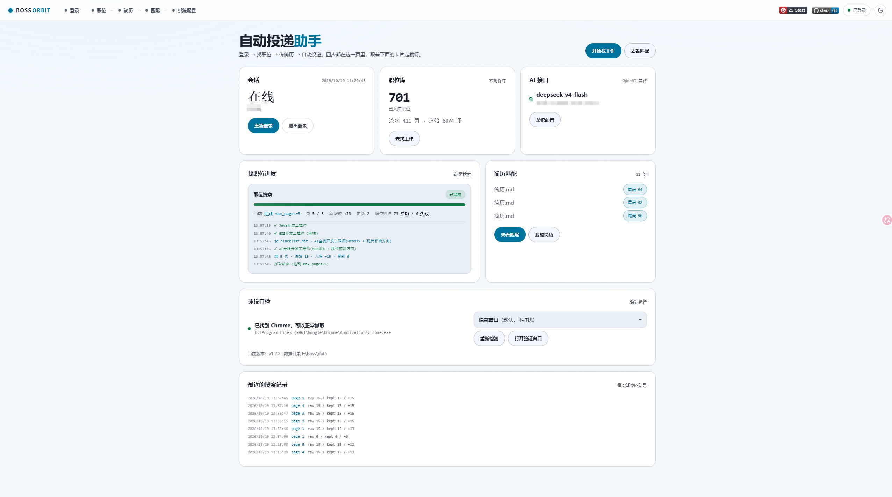

### 登录
短信验证码 / APP 扫码，滑块由你本人拖动官方组件。
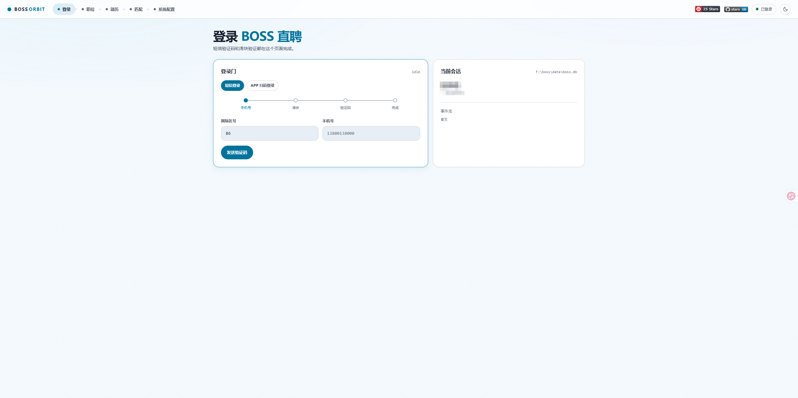

### 找职位
按条件分页抓取、卡片化浏览、选中即抓 JD。
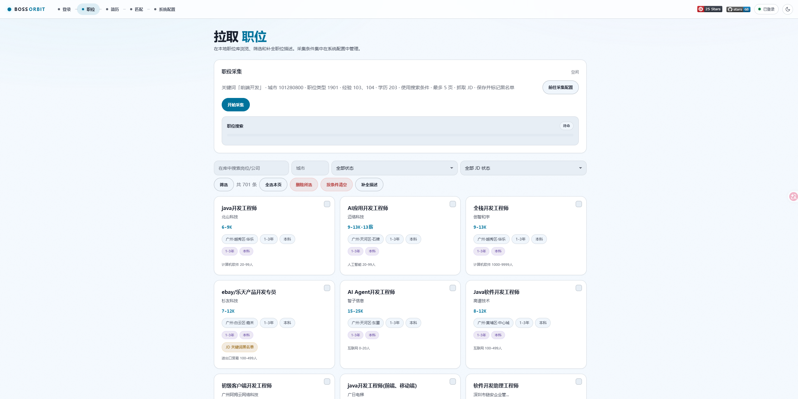

### 上传简历
Word / PDF / Markdown / 纯文本，AI 自动解析成结构化结果，结果可人工编辑。
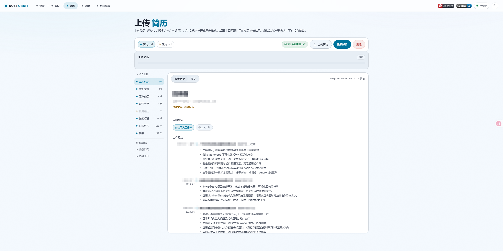

### AI 设置
OpenAI 兼容协议（DeepSeek / Kimi / 本地 vLLM 都行），Key 只存本地。
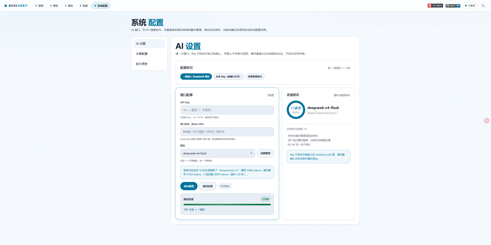

### 采集配置
城市 / 求职类型 / 薪资 / 经验 / 学历 / 行业 / 规模，含黑名单规则。
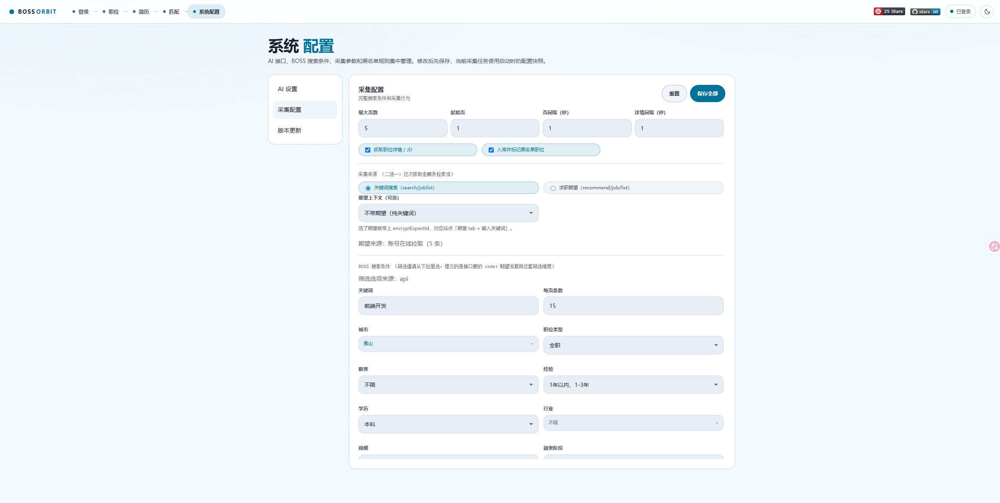

### 匹配工作台
一键匹配，AI 出匹配度、优缺点与个性化招呼语。
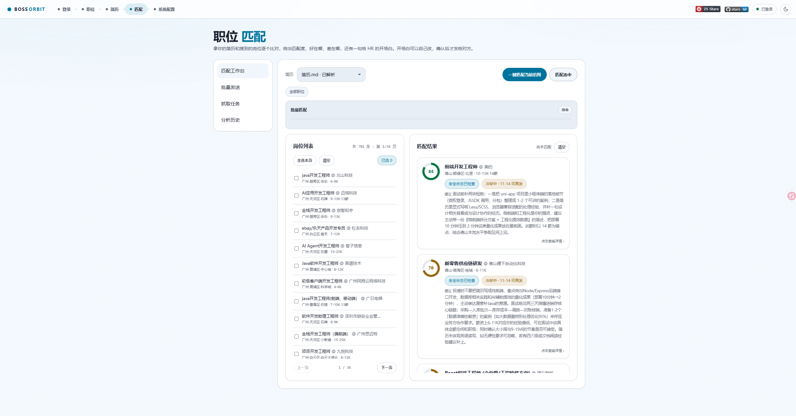

### 批量发送
一键发送全部 / 选中，带评分阈值与发送清单。
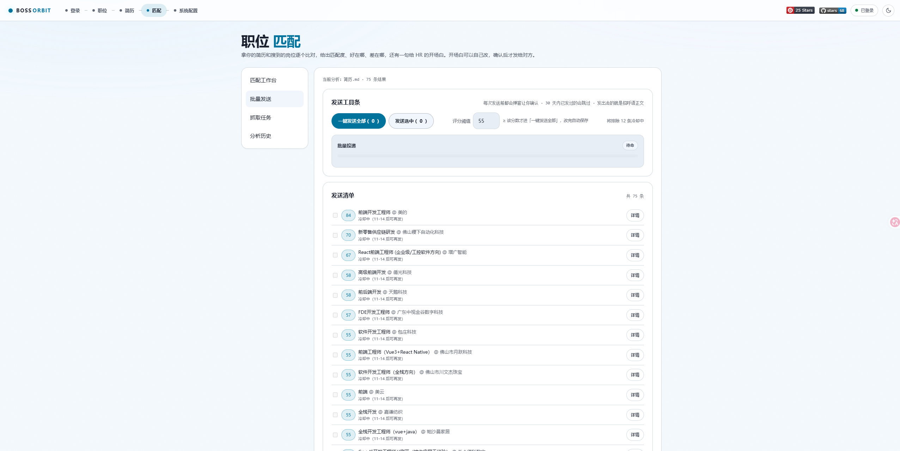

### 抓取任务
每次抓取留档，可回看条件、统计与本批岗位。
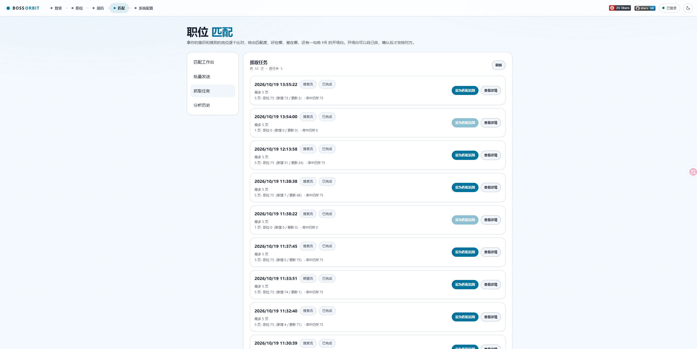

### 分析历史
历史匹配结果载入 / 删除。
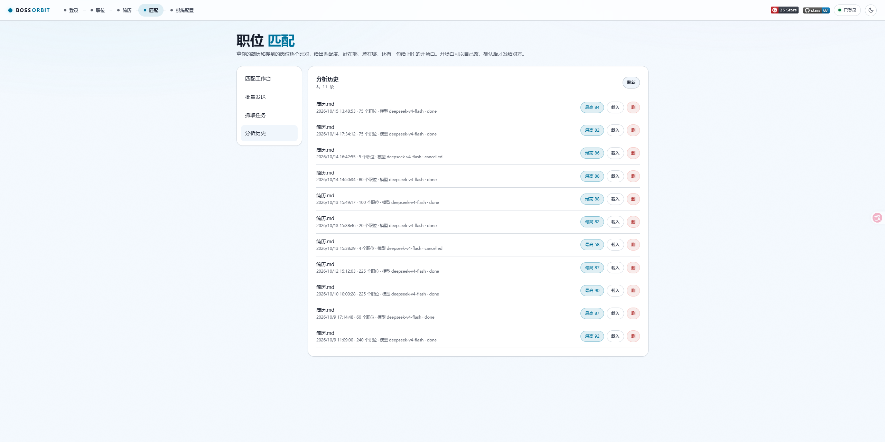

### 匹配详情
点开卡片看分析全文，底部可改招呼语并发送。
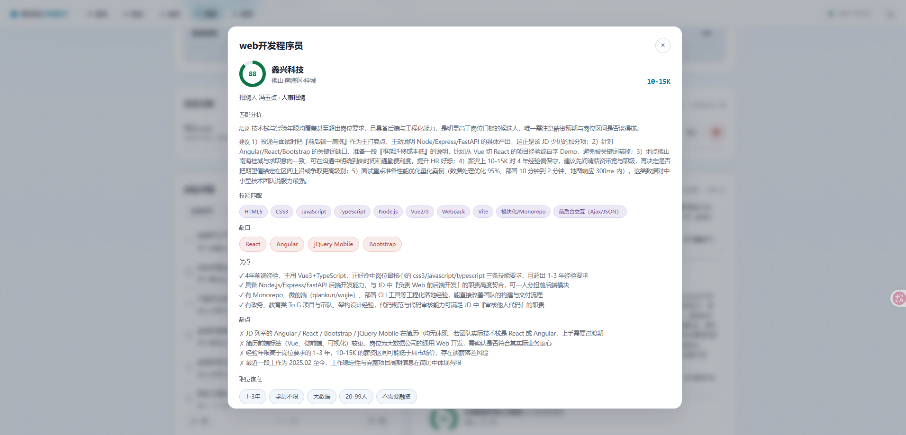

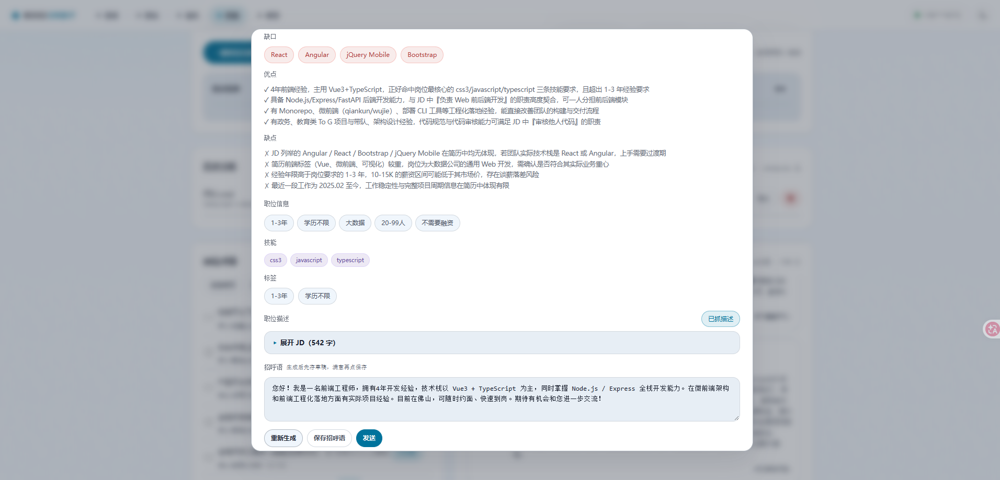

### 版本更新
手动检测、就地看更新日志、一键复制诊断信息。
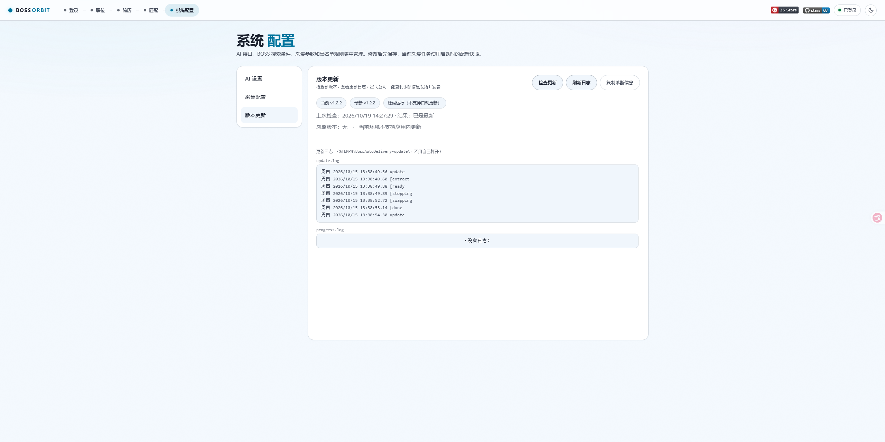

---

## 后续规划

- [X] 自定义打招呼提示词
- [X] 简历多版本管理与针对性优化
- [X] 岗位专属面试题生成
- [X] 解析结果人工编辑
- [X] 固定招呼语 / 只建会话模式
- [ ] 全流程全自动模式并添加定时任务定时发送
- [ ] 投递策略优化（时间段、频率控制）
- [ ] 支持更多招聘平台（拉勾、猎聘、前程无忧等）

---

## 免责声明

本项目仅供**学习与技术研究**使用。使用即表示你同意：

1. 遵守 BOSS 直聘的用户协议与法律法规，账号行为自负
2. 不得用于批量骚扰、数据倒卖或任何商业牟利用途
3. 控制抓取频率，不要对目标站点造成压力
4. 因使用本项目导致的任何账号限制、封禁或法律后果，作者不承担责任

若平台方认为本项目不妥，联系即下架。

License: MIT
